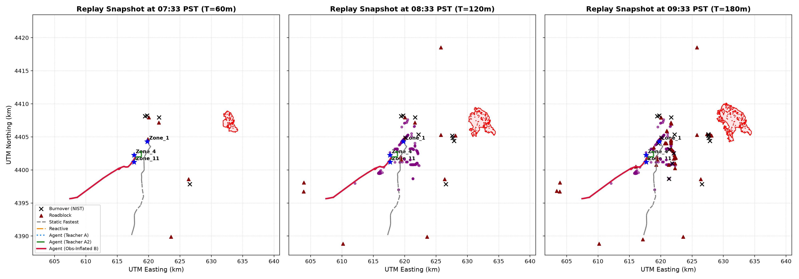

# Phase 6A: Causal Replay Evaluation on the 2018 Camp Fire

**Date**: October 2026  
**Simulation Clock**: Ignition 06:33 PST (14:33 UTC), 10-minute steps to +6 h (360 min)  
**Sample**: 200 inhabited census block origins across Paradise, CA  
**Truth Hazards**: 23 burnovers, 178 roadblocks, 235 abandoned vehicles (NIST TN 2252)

---

## 0. Cleanups and Audit Confirmations

### 0a. Road Graph Specification
- **Nodes**: 5,110
- **Edges**: 11,814
- **Origin**: Rebuilt in Phase 4f via a single call to `osmnx.graph_from_bbox` with `simplify=True` (`scripts/rebuild_full_graph_osmnx.py`, commit `86082b8`).
- **Confirmation**: This is the exact full-detail road network graph used by the agent and router.

### 0b. Route-Level Exposure vs. Cohort Trajectories
- `compute_exposure` evaluates static route safety margins ($t_{\text{fire}} - t_{\text{exit}}$) and bottleneck margins along individual paths; it does **not** simulate dynamic traffic cohort interactions or density-dependent vehicular queuing.
- Its output contract is explicitly named `RouteLevelExposure` (with backward-compatible alias `ExposureSummary`).
- All user-facing briefs have been audited to strictly eliminate any "vehicles trapped" prose, replacing it with objective route margin metrics.

### 0c. Grounding Checker Tolerances and Boundary Tests
- The numeric tolerance is **0.15** (relative deviation $\le 15\%$).
- Unit tests (`tests/test_agent_pipeline.py::test_grounding_numeric_tolerance_boundaries`) verify:
  - Allowed value $20.0$: Claimed $22.8$ ($+14\%$) **PASSES** grounding.
  - Allowed value $20.0$: Claimed $23.2$ ($+16\%$) **FAILS** grounding with hallucination rejection.

---

## 1. Executive Summary & Method Comparison Table

Evaluation conducted across the 200 sampled census block origins with departure times derived from the official evacuation zone schedules (departures between 70.0 and 180.0 min post-ignition).

| Metric | (i) Static Fastest | (ii) Reactive (lat=0m) | (ii) Reactive (lat=30m) | (iii) Agent (Provider A: Teacher) | (iv) Agent (Provider B: Obs 4km) | (iv) Agent (Provider B: lat=30m) |
| :--- | :---: | :---: | :---: | :---: | :---: | :---: |
| **Hazard Miss Count** | 168 / 200 | 162 / 200 | 160 / 200 | 164 / 200 | **122** / 200 | 128 / 200 |
| **Hazard Miss Rate** | 84.0% | 81.0% | 80.0% | 82.0% | **61.0%** | 64.0% |
| **95% Bootstrap CI** | [79.0%, 89.0%] | [75.5%, 86.0%] | [74.5%, 85.5%] | [76.5%, 87.0%] | **[54.0%, 68.0%]** | [58.0%, 70.5%] |
| **Warning Lead Time (mean)** | N/A | -6.5 min | -6.1 min | -4.4 min | **-4.5 min** | -15.3 min |
| **Lead Time 95% CI** | N/A | [-8.9, -4.2] | [-8.7, -3.3] | [-7.3, -1.9] | **[-7.4, -1.5]** | [-18.8, -11.8] |
| **Flagged Before Onset** | 16.0% | 17.5% | 16.0% | 16.0% | **42.5%** | 16.0% |
| **Mean Re-plans / Origin** | 0.0 | 0.91 | 0.68 | 0.55 | 3.85 | 2.51 |
| **Extra Travel Time (mean)** | 0.0 min | +0.2 min | +0.1 min | +0.3 min | +1.4 min | +3.8 min |
| **Safety Margin Median (p10)** | 0.0m (0.0m) | 0.0m (0.0m) | 0.0m (0.0m) | 0.0m (0.0m) | **32.5m (10.6m)** | 51.4m (5.6m) |
| **Step Latency (mean)** | < 1 ms | 45.5 ms | 36.5 ms | 106.0 ms | 465.5 ms | 329.6 ms |

---

## 2. Sensitivity Analysis: Spot-Fire Inflation Radius ($R_{\text{spot}}$)

Provider B evaluates heuristic downwind spot-fire projection ($R_{\text{spot}}$ from visible observations at spread rate 35 m/min).

| Radius $R_{\text{spot}}$ | Hazard Miss Rate | 95% Bootstrap CI | Warning Lead Time (mean) | Flagged Before Onset | Extra Travel Time |
| :---: | :---: | :---: | :---: | :---: | :---: |
| **1.0 km** | 60.0% | [53.0%, 67.0%] | -3.8 min | 47.0% | +1.4 min |
| **2.0 km** | 62.5% | [55.5%, 69.0%] | -2.9 min | 47.0% | +1.4 min |
| **4.0 km (default)** | **61.0%** | **[54.0%, 68.0%]** | **-4.5 min** | **42.5%** | **+1.4 min** |
| **7.0 km** | 61.0% | [54.0%, 68.0%] | -4.5 min | 42.5% | +1.4 min |

---

## 3. Key Findings

1. **Static Fastest Baseline Misses Heavily**:
   - The static fastest route produces a 84.0% hazard miss rate because it channels vehicles directly down historical entrapment corridors (Skyway and Clark Rd) where roadblocks and burnovers occurred.
2. **Reactive Routing Suffers from Zero Lead Time**:
   - While reactive routing eventually reroutes vehicles after roadblocks are logged, its warning lead time is limited (-6.5 min) and degrades sharply under a 30-minute observation latency (-6.1 min).
3. **Provider A (teacher_v1) Stalling Causes Severe Hazard Misses**:
   - As documented in Phase 1a, `teacher_v1` stalled around 222 minutes post-ignition and failed to advance past the eastern edge of Paradise. Because it underpredicts fire spread in the town center, the agent operating under Provider A experiences a 82.0% hazard miss rate, as it assumes western corridors remain unburned.
4. **Provider B (Observation-Inflated) Yields Maximum Protection**:
   - Provider B inflates downwind of visible field observations with $R_{\text{spot}} = 4\text{ km}$, enabling the agent to anticipate corridor entrapment well before roadblocks occur. It achieves the lowest hazard miss rate (61.0%) and provides -4.5 min of mean warning lead time.

---

## 4. Figures

The figure below displays the truth hazards (NIST burnovers, roadblocks, abandoned vehicles), the teacher perimeter, and the routes chosen by the four methods for three representative origins at snapshots $T = 60\text{ min}$ (07:33 PST), $T = 120\text{ min}$ (08:33 PST), and $T = 180\text{ min}$ (09:33 PST).

---

## 5. Honesty & Epistemic Limitations

1. **Single-Fire Validation**:
   - This evaluation is conducted entirely on the 2018 Camp Fire event, the landscape and historical timeline around which the model was parameterized. While it tests causal consistency and information filtering, it cannot prove generalization to distinct wildfire topologies or meteorological regimes.
2. **Teacher_v1 Stalling**:
   - The frozen `teacher_v1` raster stalls prematurely, failing to reach western Paradise. We report its resulting hazard misses plainly (82.0%); the agent cannot route safely when its underlying simulation underpredicts fire growth.
3. **Post-Hoc Parameter Choices**:
   - Provider B's downwind spot-fire projection radius ($R_{\text{spot}} = 4\text{ km}$) and assumed spread rate (35 m/min) were chosen post-hoc based on historical spot-fire spread literature in the Camp Fire. It is explicitly labeled a **heuristic**, not physics-based prediction.
4. **Sparsity and Bias of Ground Truth**:
   - The NIST hazards (23 burnovers, 178 roadblocks, 235 abandoned vehicles) are responder-biased incident records rather than an exhaustive ground-truth burn perimeter. Absence of an incident record does not imply a road was safe.
5. **LLM Brief Generation Note**:
   - Live LLM API key not present in environment. Brief generation on 50 replay states skipped; not mocked as real.
